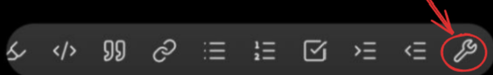
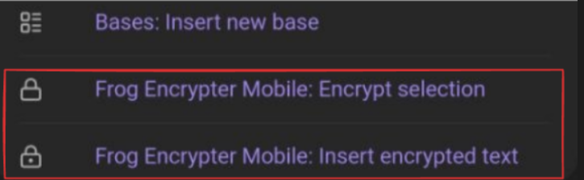
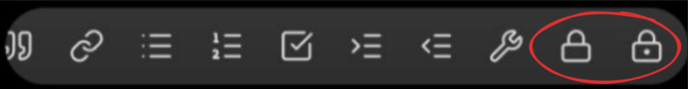

# Frog Encrypter Mobile

**Encryption of text fragments, notes, and files inside the Obsidian vault.**

Frog Encrypter Mobile lets you encrypt selected text, entire notes, and any files directly inside Obsidian. Files are encrypted using **AES-256-GCM** and **PBKDF2 (SHA-512)** algorithms.

> 📱💻 **Works on mobile devices and desktop.** The plugin is optimized for mobile, but also works on desktop systems. However, for desktop we recommend **[Frog Encrypter](https://community.obsidian.md/plugins/frog-encrypter)** — its version uses Electron APIs for byte-level file reading and writing, and chunked processing, which makes encryption significantly gentler on RAM, and it has additional features.

---

## ❤️ Support

If you find Frog Encrypter Mobile useful, please support development:

- ⭐ Star the repository
- ☕ [Buy me a coffee](https://buymeacoffee.com/rainfr0g)

Author: **[RainFr0g](https://github.com/RainFr0g)**

---

## ✨ Features

- **Text encryption** — only the selected fragment inside a note is encrypted.
- **Note encryption** — the note becomes a `.mdenc` file but remains editable directly in Obsidian.
- **File encryption** — any file supported by Obsidian is encrypted into `.fenc`.
- **Compression** — optional DEFLATE compression before encryption, configurable by file extension.
- **Password manager** — stores passwords in memory for a set time and automatically tries them on every decryption.

---

## 🔄 Compatibility

Files created by this version are **fully compatible** with the desktop [Frog Encrypter](https://github.com/RainFr0g/frog-encrypter). You can encrypt a note on your phone and decrypt it on desktop, and vice versa.

---

## 📂 Supported formats

Frog Encrypter Mobile can encrypt and decrypt any file type supported by Obsidian, including formats added by third-party plugins. Obsidian out of the box supports **24 file types**.

| Category           | Extensions                                                 | Behavior when encrypted |
| ------------------ | ---------------------------------------------------------- | ----------------------- |
| Notes              | `.md`                                                      | ✅ View and edit        |
| Images             | `.png` `.jpg` `.jpeg` `.bmp` `.svg` `.webp` `.avif` `.gif` | ✅ View only            |
| Audio              | `.mp3` `.wav` `.m4a` `.flac` `.oga` `.ogg` `.opus` `.3gp`  | ✅ Listen only          |
| Video              | `.mp4` `.webm` `.mov` `.mkv` `.ogv`                        | ✅ View only            |
| Documents          | `.pdf`                                                     | ❌ Requires decryption  |
| Visual notes       | `.canvas`                                                  | ❌ Requires decryption  |

In total, **22 out of 24** formats can be previewed directly in encrypted form. Only **PDF** and **Canvas** require full decryption.

---

## 🖱 Usage

### In the editor

#### Encryption

You can encrypt text using the command palette, or for convenience, add these commands to the editor toolbar.

**How to add commands to the toolbar:**

**Step 1.** Open the toolbar settings:

**Step 2.** Add the desired Frog Encrypter command:

**Step 3.** Enjoy:

Available commands:

- **Encrypt selection** — encrypt the selected text (appears only when text is selected)
- **Insert encrypted text** — open a modal window to enter text and a password

#### Decryption

In encrypted text, you will see a **lock icon**.

- **Short press** — open the decryption window.
- **Long press** (or right-click on desktop) — open a context menu with options:
  - **Decrypt** — decrypt with the option to edit and save
  - **Decrypt and copy** — decrypt and immediately copy the result to the clipboard

### In the file explorer

Long press (or right-click on desktop) on a file or folder:

- **Note** → **Encrypt note**
- **File** → **Encrypt file**
- **Encrypted note** → **Decrypt note**
- **Encrypted file** → **Decrypt file**
- **Folder or empty space** → **New encrypted note**

### Ribbon buttons

- **New encrypted note** — create a new empty encrypted note in the default notes folder
- **Lock all encrypted notes and files** — close all open encrypted tabs
- **Clear password cache** — forcibly clear the password cache

---

## ⚙️ Settings

- **Confirm password** — asks for password confirmation when encrypting to avoid typos
- **Remember password** — enables storing entered passwords in memory
- **Autofill recent password** — automatically fills in the last successfully used password
- **Password lifetime** — how long a password remains in memory after the last manual entry (TTL)
- **Compression mode**:
  - `Always` — compress everything
  - `Never` — do not compress
  - `Compress by extension` — configure rules by extension (e.g., compress `.txt`, skip `.jpg`)

---

## 🔐 Security

- **Algorithm:** AES-256-GCM
- **Key derivation:** PBKDF2 (SHA-512) with 200,000 iterations
- **Compression:** DEFLATE (via [pako](https://github.com/nodeca/pako))
- **Storage:** encrypted data is stored in base64 (strings and notes) or in binary format (files)
- **Chunking:** file encryption uses asynchronous chunked processing. Chunking is not used for strings and notes.

---

## 🚀 Performance

**PBKDF2 as protection against brute force.** Key derivation uses **PBKDF2 with 200,000 SHA-512 iterations**. This is deliberate — it makes password brute-forcing computationally expensive, extending the search time from hours to hundreds of years. The trade-off is that each new `(password, salt)` pair requires a one-time key derivation, which takes a noticeable amount of time.

When **Remember password** is enabled, saved passwords are automatically tried against each encrypted file. With only a few passwords in memory, this is imperceptible. With **more than 10 passwords**, trying them sequentially can push decryption time **past one second**, and it keeps growing with each additional password. Keep a reasonable number of passwords in memory to avoid slowdowns when opening your records.

If speed matters more than convenience, disable **Remember password** and enter the password manually — then each decryption involves exactly one PBKDF2 derivation, with no trial-and-error.

**The delay only applies to files opened for the first time.** Once a file has been successfully decrypted with a given password, its derived key is cached in memory. Subsequent opens of the same file reuse the cached key and skip PBKDF2 entirely, making them essentially instant.

**Compression — a trade-off between speed and size.** Running DEFLATE before encryption noticeably slows down encryption and decryption of **large** files, since compression costs CPU time. However:

- On **text documents** (`.md`, `.txt`, `.json`, `.xml`, `.html`, source code), compression typically reduces size by **3–10×**, while the speed cost is minor — text compresses quickly.
- On **media files** (`.jpg`, `.png`, `.mp4`, `.mp3`), compression brings almost no size reduction but still spends time. That's why they are **excluded** from compression by default.
- On **already-compressed archives** (`.zip`, `.7z`, `.gz`), DEFLATE is useless — they are already compressed.
- On **large binary files** (`.exe`, `.dll`, `.iso`), compression can slow the operation down several times without a meaningful size gain.

By default, the **Compress by extension** mode is used with a sensible set of rules. If maximum speed matters, switch the mode to `Never`.

---

## ⚖️ Comparison with the desktop version

Frog Encrypter Mobile works on both mobile devices and desktop, but it has **fundamental differences** from the desktop version [Frog Encrypter](https://community.obsidian.md/plugins/frog-encrypter), due to platform limitations.

### Frog Encrypter (Desktop)

The desktop version uses **Electron APIs** (`fs`, `path`), which gives it two key advantages:

- **Byte-level file reading and writing** — the file is not loaded entirely into memory, but processed as a stream, chunk by chunk.
- **Streaming encryption of large files** — even when encrypting a file of several gigabytes, RAM usage remains consistently low, around **20–30 MB**, regardless of file size.

The desktop version can also encrypt **external files** — those located outside the Obsidian vault, via system dialogs.

### Frog Encrypter Mobile

Mobile Obsidian **does not provide access to Electron APIs**, so the plugin uses the Vault API:

- **`vault.readBinary()` loads the entire file into an `ArrayBuffer`** — RAM usage scales with the file size.
- **When encrypting large files**, memory consumption grows proportionally to the file size, which makes working with very large files demanding on RAM. On devices with limited memory, this may cause slowdowns or app termination.
- **No external file support** — mobile Obsidian does not provide system file dialogs.
- **No archive packing** — the `.fpack` feature from the desktop version is unavailable.

---

## ⚠️ Warning

> **Use at your own risk**
>
> - Passwords are **never stored** in plaintext. If you forget your password, **data cannot be recovered**.
> - The encryption methods used **have not undergone an independent audit**.
> - Bugs may appear at any time. **You are fully responsible for data safety and keeping regular backups.**